# Project Webpage — Consulting Case Study HTML Generator

**Turn a consulting project write-up into a professional portfolio page — no HTML skills required.**

## The Problem

Most consultants document their work in PowerPoint and Word. When it's time to build a portfolio, those files sit in a folder that's impossible to share with a potential client or employer. Writing a clean, professional web page from scratch takes days — and requires design and HTML skills most consultants don't have.

The alternative — a PDF export or a plain text summary — doesn't do the work justice. Analysis frameworks, deliverable breakdowns, and quantitative insights lose all their visual impact when flattened into paragraphs.

## What This Skill Does

Project Webpage reads your consulting project materials and generates a self-contained, professionally designed HTML portfolio page. Drop in a Word doc, a PowerPoint, or just describe the project in conversation — the skill handles structure, design, and content sanitization.

**What you get:**

- **A complete single-file HTML page** — no build step, no dependencies, opens in any browser
- **Professional navy-and-gold design** — Playfair Display headings, clean section layouts, subtle scroll animations
- **Full content fidelity** — every analysis section, deliverable, and metric from your source material, reorganized for visual impact
- **Built-in client anonymization** — real client names are replaced with neutral descriptors ("Leading State-Owned Developer", "BRICS Multilateral Development Bank") — safe to publish publicly
- **Component-rich layouts** — card grids, layer stacks, stat callouts, benchmark tables, and tag clouds map your content to the right visual pattern automatically

## Input / Output

### Input

Provide any of:
- **A Word doc** (`.docx`) — project case study, engagement summary, or final report
- **A PowerPoint** (`.pptx`) — final deck or working slides
- **Conversation** — describe the project context, analysis areas, and key deliverables
- **An existing project folder** — the skill can scan and summarize before generating

Minimum needed: project title, client context, 2–3 analysis areas or deliverables, and any key metrics.

**Sample input (conversation):**

```
Project: Post-Acquisition Integration Planning for a Canadian gold mine
Client: Mining company transitioning to full ownership after PE acquisition
Duration: 3 months
Key deliverables:
  - 100-day integration roadmap across Finance, Technology, and Legal
  - IFRS compliance workplan (IFRS 15 revenue recognition, Big Four coordination)
  - Activity-level program tracker with RACI and milestone flags
Sector: Mining / Private Equity
```

### Output

A single self-contained `.html` file that opens in any browser, in any of thirteen styles. Every thumbnail shows the same sample project summary — click one to open that template.

<table>
<tr>
<td align="center" valign="top" width="33%"><a href="references/themes/harbour.html">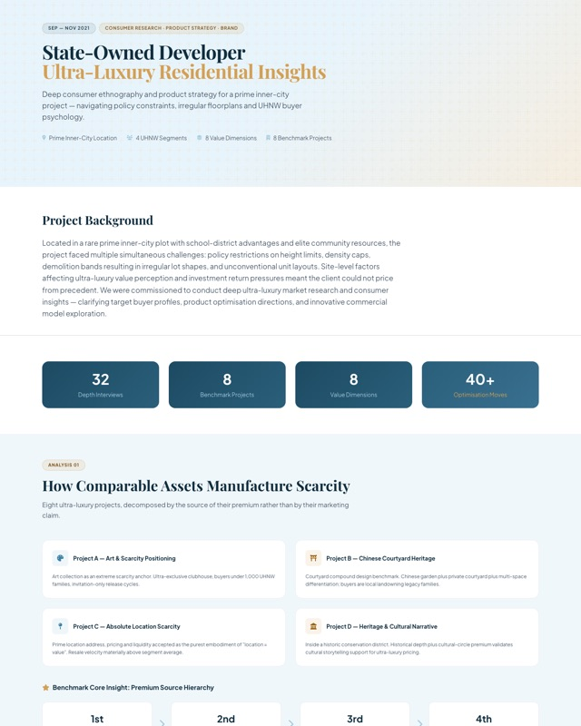</a><br><b>Harbour</b><br><sub>The original and default — navy, sky blue, gold</sub></td>
<td align="center" valign="top" width="33%"><a href="references/template.html">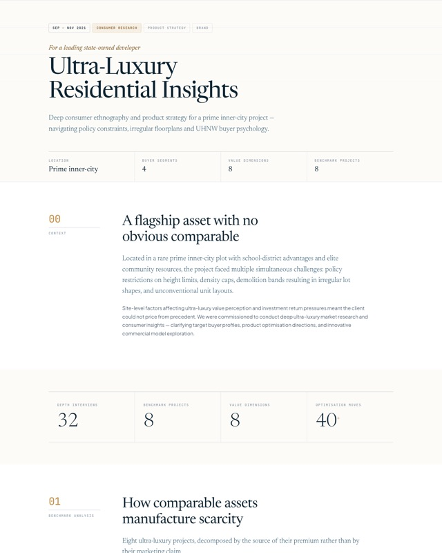</a><br><b>Editorial</b><br><sub>Canonical editorial design system</sub></td>
<td align="center" valign="top" width="33%"><a href="references/themes/accented.html">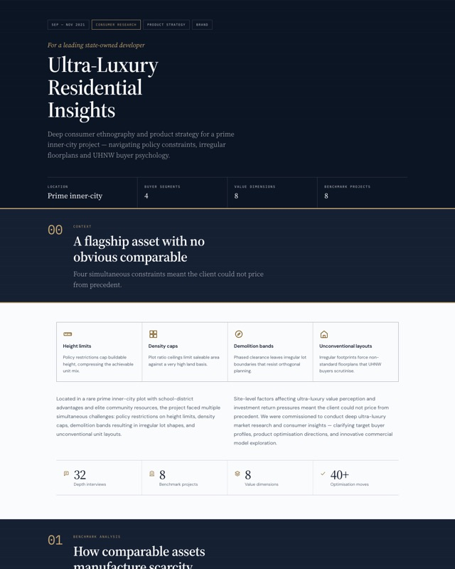</a><br><b>Accented</b><br><sub>Navy section bands on cool blue-grey</sub></td>
</tr>
<tr>
<td align="center" valign="top" width="33%"><a href="references/themes/mat.html">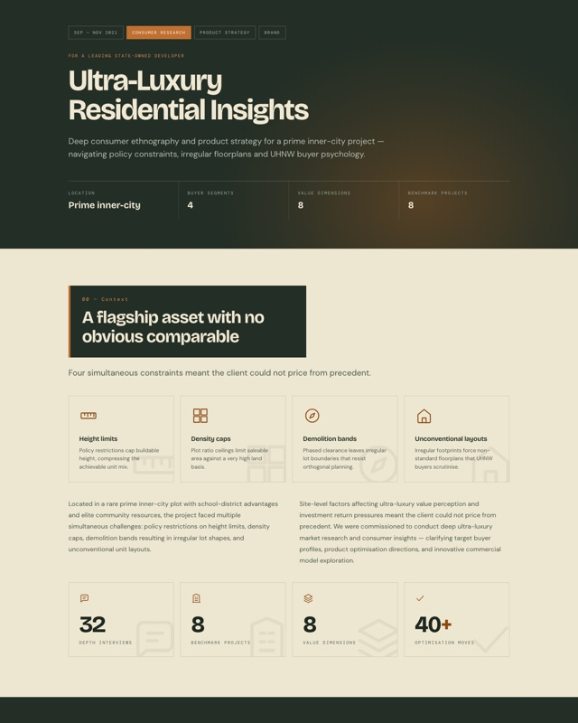</a><br><b>Mat</b><br><sub>Forest green and cream environments</sub></td>
<td align="center" valign="top" width="33%"><a href="references/themes/signal.html">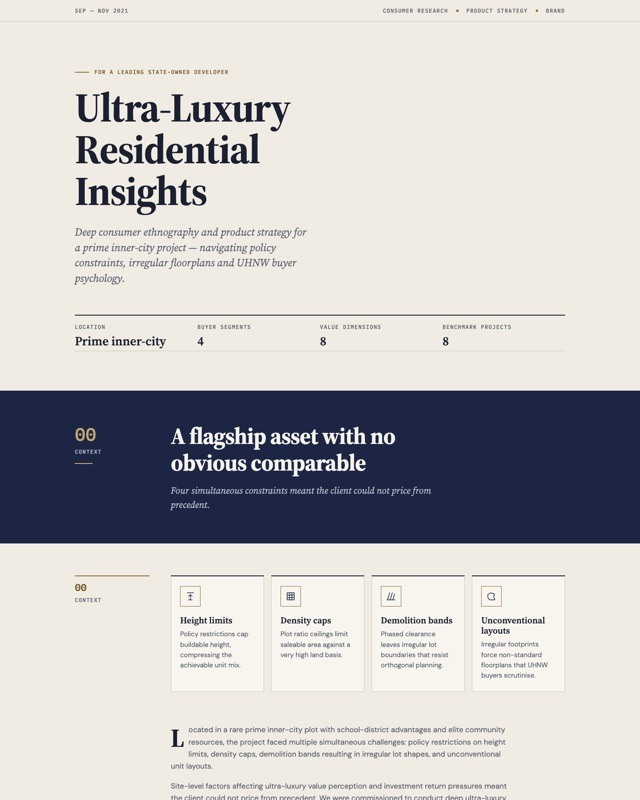</a><br><b>Signal</b><br><sub>Sticky rail, navy bands on cream</sub></td>
<td align="center" valign="top" width="33%"><a href="references/themes/monochrome.html">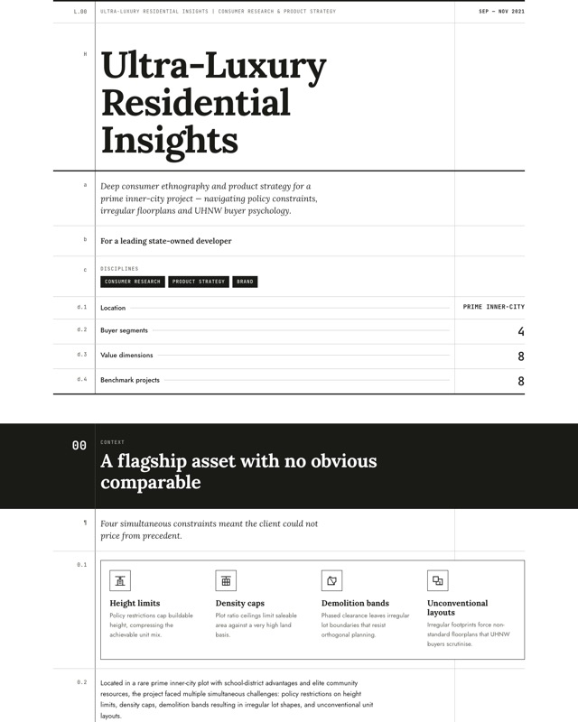</a><br><b>Monochrome</b><br><sub>Accounting ledger, black on white</sub></td>
</tr>
<tr>
<td align="center" valign="top" width="33%"><a href="references/themes/cartesian.html">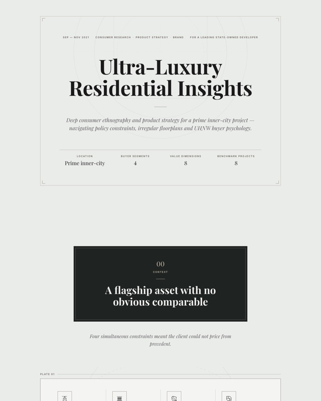</a><br><b>Cartesian</b><br><sub>Museum monograph with framed plates</sub></td>
<td align="center" valign="top" width="33%"><a href="references/themes/cobalt-grid.html">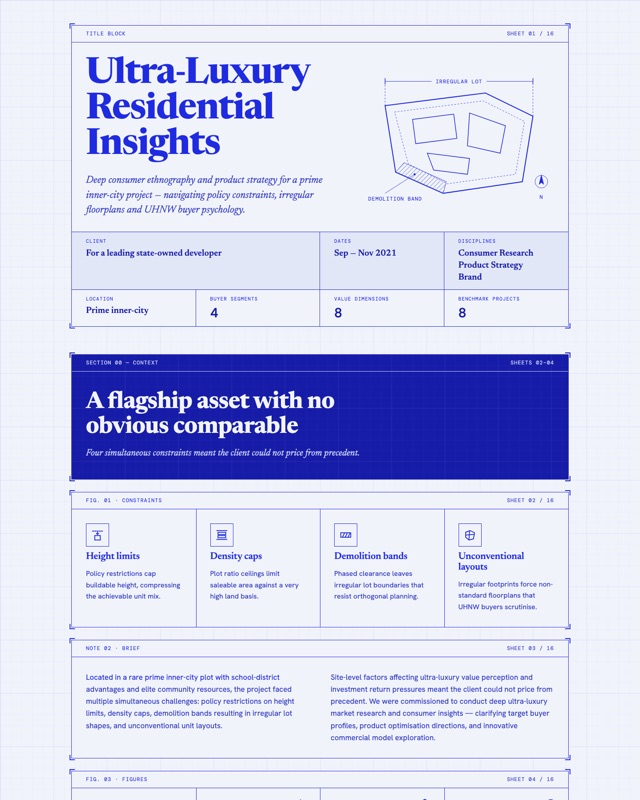</a><br><b>Cobalt Grid</b><br><sub>Engineering drawing sheet</sub></td>
<td align="center" valign="top" width="33%"><a href="references/themes/emerald-editorial.html">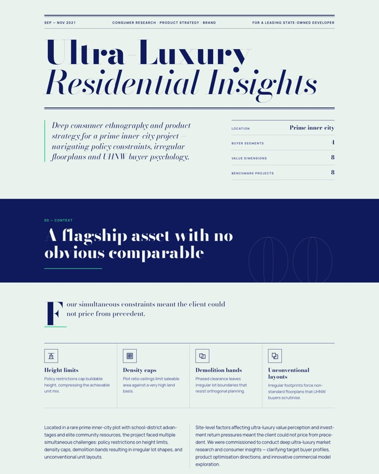</a><br><b>Emerald Editorial</b><br><sub>Magazine feature with masthead</sub></td>
</tr>
<tr>
<td align="center" valign="top" width="33%"><a href="references/themes/blue-professional.html">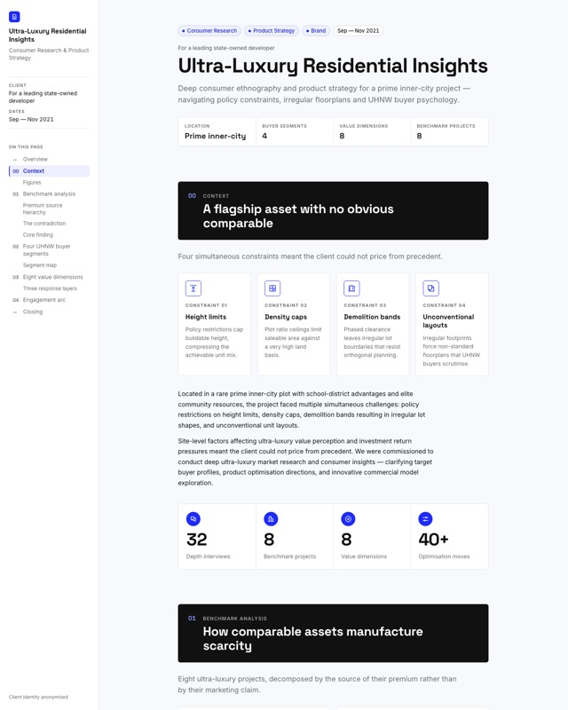</a><br><b>Blue Professional</b><br><sub>Product docs with sidebar contents</sub></td>
<td align="center" valign="top" width="33%"><a href="references/themes/editorial-tri-tone.html">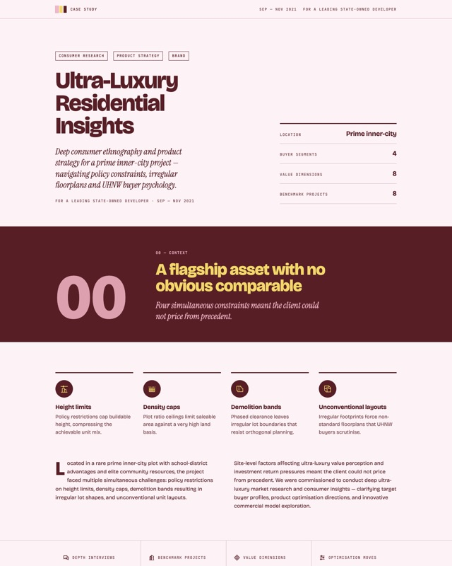</a><br><b>Editorial Tri-Tone</b><br><sub>Poster report in blush and crimson</sub></td>
<td align="center" valign="top" width="33%"><a href="references/themes/biennale-yellow.html">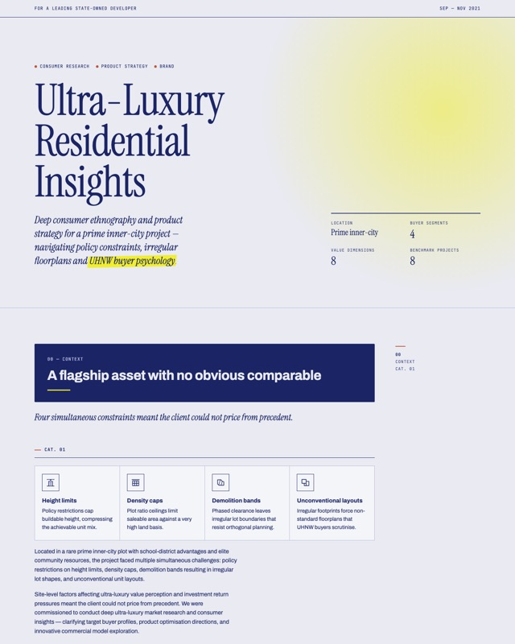</a><br><b>Biennale Yellow</b><br><sub>Exhibition catalogue, alternating rooms</sub></td>
</tr>
<tr>
<td align="center" valign="top" width="33%"><a href="references/themes/raw-grid.html">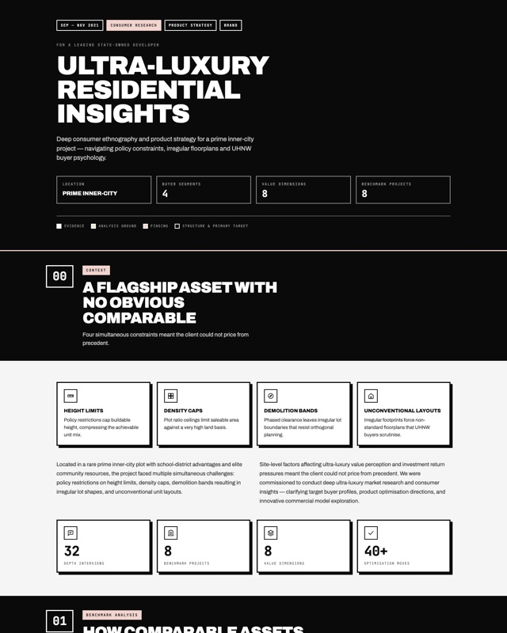</a><br><b>Raw Grid</b><br><sub>Neobrutalist block grid</sub></td>
</tr>
</table>

## Installation

```bash
git clone https://github.com/wendilyspark/project-webpage.git ~/.claude/skills/project-webpage
```

**Prerequisites:** [Claude Code](https://docs.anthropic.com/en/docs/claude-code) CLI installed.

No other dependencies — the generated HTML uses CDN-hosted Tailwind CSS and Google Fonts.

## Usage

Once installed, trigger the skill by describing what you want:

```
> Make an HTML portfolio page for my integration planning project

> Turn this Word doc into a consulting case study webpage

> Generate a project showcase page — I'll describe the engagement

> /project-webpage
```

You can also invoke it directly with `/project-webpage` in any Claude Code session.

**The skill will:**
1. Ask for (or read) your source material
2. Extract all content — every bullet, every metric, every deliverable
3. Propose a sanitized client descriptor for your review
4. Generate the HTML file and save it to the location you specify
5. Offer to iterate on layout, color balance, or content depth

## License

MIT
